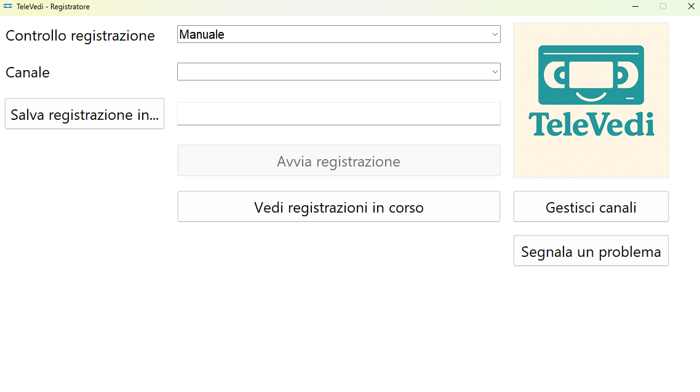
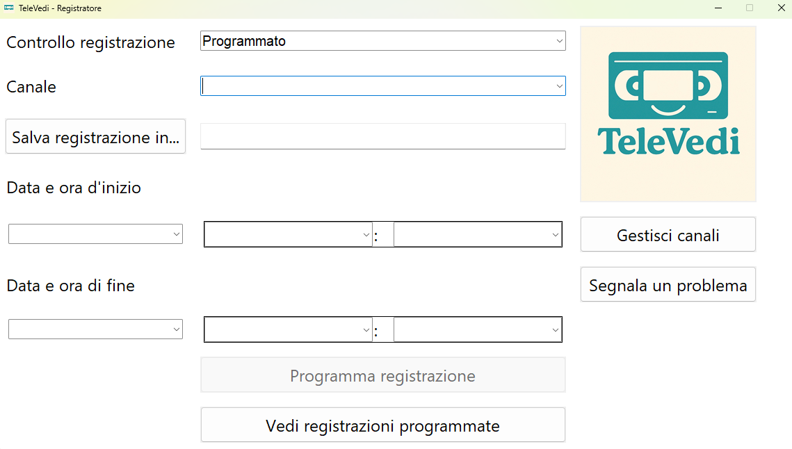
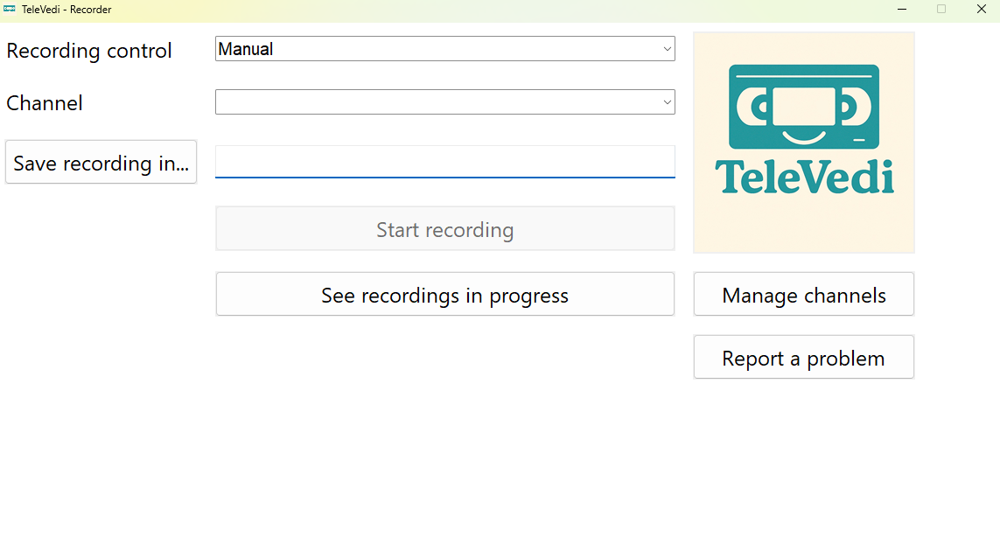
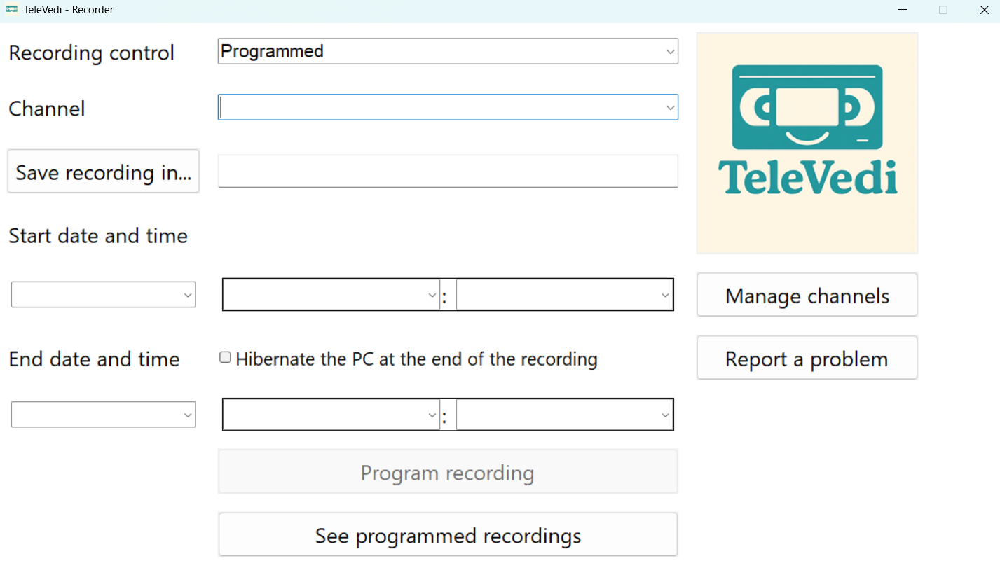
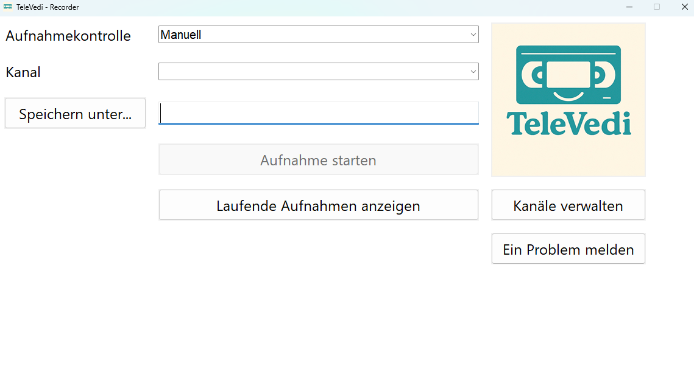
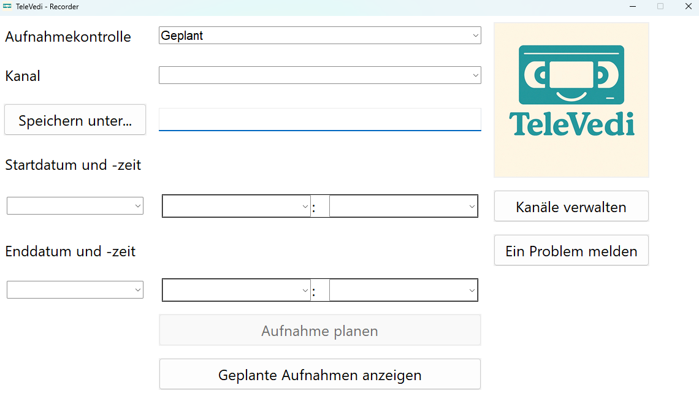

# TeleVedi

## 🌍 Lingua / Language / Sprache

- 🇮🇹 [Italiano](#italiano)
- 🇬🇧 [English](#english)
- 🇩🇪 [Deutsch](#deutsch)

## Italiano

  
  

    <strong>TeleVedi - Registratore</strong> è un programma che consente di gestire registrazioni di trasmissioni streaming in tempo reale o in una fascia oraria programmata.
  

## 📦 Contenuto del pacchetto

- `Registratore.py`: Script principale
- `TeleVediInstaller.py`: Script per installare i componenti indispensabili per il funzionamento del programma
- `TeleVediUninstaller.py`: Script per disinstallare lo scheduler del programma
- Script PHP, batch e Python di supporto
- `ffmpeg.exe`, `php.exe`, `yt-dlp.exe`: Eseguibili necessari
- File di configurazione: `.json`, `.txt`

## 🛠 Requisiti

- Sistema operativo: Windows 10 (con architettura a 64 bit) o superiore
- Python 3.10 o successivo [(download qui)](https://www.python.org/downloads/)

## 🚀 Installazione

- Eseguire `TeleVediInstaller.bat` per:
  - verificare che sia installata una versione di Microsoft Visual C++ Runtime uguale o successiva alla v14.40 e, in caso contrario, installare la versione richiesta per il funzionamento del programma
  - installare lo scheduler necessario per poter programmare le registrazioni
  - creare il collegamento `TeleVedi` da cui avviare il programma

## ▶️ Avvio

Avviare il programma aprendo il collegamento `TeleVedi`. Al primo avvio, accettare le condizioni di utilizzo del programma.

## 📖 Istruzioni per l'utilizzo

Il programma permette di registrare flussi streaming a partire da una lista di canali fornita dall'utente.

L'utente può gestire la sua lista di canali tramite il bottone `Gestisci canali`, da cui è possibile:
- importare i canali da playlist .m3u
- aggiungere canali manualmente
- modificare i canali esistenti
- eliminare i canali esistenti
- controllare se i canali della lista sono raggiungibili

È testato il funzionamento con i link a:
- file .m3u8
- file .mpd
- dirette YouTube
- canali Twitch

Dopo aver creato la lista di canali, selezionare il tipo di registrazione che si intende impostare:
- `Manuale` per la registrazione in diretta (da avviare e interrompere manualmente)
- `Programmato` per schedulare una registrazione in futuro (che si avvia e si ferma in automatico)

Riempire quindi tutti i campi visibili. In presenza di campi non riempiti o di valori non coerenti, non sarà possibile avviare o programmare la registrazione.

Tenere in considerazione che le registrazioni programmate non vengono avviate né fermate esattamente allo scattare del minuto impostato, ma possono esserci dei ritardi inferiori al minuto.

⚠️ Nella fascia oraria in cui una registrazione è programmata, il computer deve rimanere acceso e sbloccato. Assicurarsi quindi che il blocco automatico dello schermo sia disabilitato per tutta la durata della registrazione. Si consiglia di accendere il computer almeno 5 minuti prima rispetto all'orario di inizio della registrazione programmata. 

⚠️ Quando una registrazione viene avviata, si apre una finestra che mostra l'avanzamento della registrazione. La chiusura di tale finestra interrompe forzatamente la registrazione, pertanto fare attenzione a non chiuderla.

⚠️ Durante tutta la durata della registrazione, il computer deve rimanere connesso ad Internet.

## 🧹 Disinstallazione

⚠️ Eseguire le seguenti istruzioni nell'ordine indicato:
- avviare `TeleVediUninstaller.bat` per disinstallare lo scheduler del programma
- cancellare l'intera cartella `TeleVedi`

## ⚖️ Licenze

Consulta il file `LICENSES-it.txt` per i dettagli sulle licenze dei componenti inclusi.

## 📜 Note legali

- L’uso di yt-dlp per scaricare contenuti da internet è responsabilità dell’utente.
- FFmpeg è distribuito secondo i termini della licenza GPL. Il codice sorgente corrispondente è disponibile su [GitHub FFmpeg](https://github.com/FFmpeg/FFmpeg).
- PHP è distribuito secondo la PHP License v3.01.

## 📢 Disclaimer Legale

La funzione di registrazione offerta da questo software è destinata esclusivamente a un **uso personale e privato**. In conformità con la normativa italiana (Legge n. 633/1941) e le direttive europee in materia di diritto d’autore (Direttiva 2001/29/CE), è consentito registrare contenuti solo per visione privata, nel rispetto delle seguenti condizioni:

✅ È consentito:
- Registrare trasmissioni provenienti da fonti lecite per uso personale
- Conservare le registrazioni nel proprio archivio privato
- Visionare i contenuti registrati in ambito domestico

❌ È vietato:
- Eludere misure tecnologiche di protezione
- Condividere, pubblicare o ritrasmettere i contenuti registrati
- Utilizzarli per scopi commerciali, didattici o pubblici
- Alterare o manipolare i contenuti per finalità diverse dalla visione privata

⚖️ Riferimenti normativi:
- Legge n. 633/1941, art. 71-sexies (Copia privata)
- Direttiva 2001/29/CE del Parlamento Europeo
- Sentenza CGUE C-265/16 del 29 novembre 2017
- SIAE – [Copia Privata](https://www.siae.it/it/cosa-facciamo/altri-servizi/copia-privata/)

⚠️ L’utente è l’unico responsabile dell’uso che fa del software.  
L’autore non incoraggia né approva l’utilizzo del programma per violare le leggi sul diritto d’autore o per accedere a contenuti criptati, a pagamento o protetti da DRM.

Per qualsiasi dubbio sull’uso legale del software, si consiglia di consultare un esperto legale o fare riferimento alla [Legge sul Diritto d’Autore (L. 633/1941)](https://www.normattiva.it/uri-res/N2Ls?urn:nir:stato:legge:1941;633).

## English

  
  

    <strong>TeleVedi - Recorder</strong> is a program that allows users to manage the recording of streams either in real time or within a scheduled time range.
  

## 📦 Package Content

- `Registratore.py`: Main script
- `TeleVediInstaller.py`: Script to install the required components
- `TeleVediUninstaller.py`: Script to uninstall the program scheduler
- PHP, Batch and Python support scripts
- `ffmpeg.exe`, `php.exe`, `yt-dlp.exe`: Required executables
- Configuration files: `.json`, `.txt`

## 🛠 Requirements

- Operating system: Windows 10 (64-bit architecture) or later
- Python 3.10 or higher [(download here)](https://www.python.org/downloads/)

## 🚀 Install

- Run `TeleVediInstaller.bat` to:
  - check if Microsoft Visual C++ Runtime version 14.40 or higher is installed, and install it if necessary
  - create a `TeleVedi` shortcut to launch the program

## ▶️ Start

To start the program, open the `TeleVedi` shortcut. On first launch, accept the Terms of Use.

## 📖 Instructions for Use

The program allows users to record streams based on a custom channel list.

Users can manage their channel list using the `Manage channels` button, which allows them to:
- import channels from an .m3u playlist
- manually add channels
- edit existing channels
- remove existing channels
- check the availability of channels in the list

Functionality has been tested with links to:
- .m3u8 files
- .mpd files
- YouTube live streams
- Twitch channels

After creating the channel list, select the desired recording mode: 
- `Manual` to record in real time (start and stop manually)
- `Programmed` to schedule a future recording (start and stop automatically)

Fill in all visible fields. If any fields are left empty or contain inconsistent values, it won't be possible to start or schedule the recording.

Please note that scheduled recordings do not start or stop exactly at the set minute; slight delays of less than one minute may occur.

⚠️ During the scheduled recording time, the computer must remain turned on and unlocked. Make sure to disable automatic screen lock for the entire duration of the recording. It is recommended to turn on the computer at least 5 minutes before the scheduled start time. 

⚠️ When a recording starts, a window displaying the recording progress will open. Closing this window will forcibly stop the recording, so be careful not to close it.

⚠️ The computer must remain connected to the Internet for the entire duration of the recording.

## 🧹 Uninstall

⚠️ Follow these steps in the specified order:
- run `TeleVediUninstaller.bat` to uninstall the program scheduler
- delete the entire `TeleVedi` folder

## ⚖️ Licenses

Refer to `LICENSES-en.txt` for details about the licenses of the included components.

## 📜 Legal Notes

- Users are solely responsible for using yt-dlp to download content from the Internet.
- FFmpeg is distributed under the terms of the GPL license. The corresponding source code is available on [GitHub FFmpeg](https://github.com/FFmpeg/FFmpeg).
- PHP is distributed under the PHP License v3.01.

## 📢 Legal Disclaimer

The recording feature provided by this software is intended exclusively for **personal and private use**.
In accordance with European directives on copyright (Directive 2001/29/EC), content may be recorded solely for private viewing, under the following conditions:

✅ Permitted:
- Recording broadcasts from lawful sources for personal use
- Storing recordings in a private archive
- Viewing recorded content in a domestic setting

❌ Prohibited:
- Circumventing technological protection measures
- Sharing, publishing, or retransmitting recorded content
- Using recordings for commercial, educational, or public purposes
- Altering or manipulating content for purposes other than private viewing

⚖️ Regulatory References:
- Directive 2001/29/EC of the European Parliament

⚠️ The user is solely responsible for how the software is used.
The author does not encourage or endorse the use of this program to violate copyright laws or to access encrypted, paid, or DRM-protected content.

For any doubts regarding the legal use of the software, it is recommended to consult a legal expert or refer to the Copyright Law.

## Deutsch

  
  

    <strong>TeleVedi - Recorder</strong> ist ein Programm, das es Nutzern ermöglicht, die Aufnahme von Streams entweder in Echtzeit oder innerhalb eines geplanten Zeitraums zu verwalten.
  

## 📦 Lieferumfang

- `Registratore.py`: Hauptskript
- `TeleVediInstaller.py`: Skript zur Installation der erforderlichen Komponenten
- `TeleVediUninstaller.py`: Skript zur Deinstallation des Programmplaners
- Unterstützungsskripte für PHP, Batch und Python
- `ffmpeg.exe`, `php.exe`, `yt-dlp.exe`: Erforderliche ausführbare Dateien
- Konfigurationsdateien: `.json`, `.txt`

## 🛠 Anforderungen

- Betriebssystem: Windows 10 (64-Bit-Architektur) oder neuer
- Python 3.10 oder höher [(hier herunterladen)](https://www.python.org/downloads/)

## 🚀 Installation

- Führen Sie `TeleVediInstaller.bat` aus, um:
  - zu überprüfen, ob Microsoft Visual C++ Runtime Version 14.40 oder höher installiert ist, und sie gegebenenfalls zu installieren
  - eine `TeleVedi`-Verknüpfung zu erstellen, um das Programm zu starten

## ▶️ Programmstart

Um das Programm zu starten, öffnen Sie die Verknüpfung `TeleVedi`. Beim ersten Start akzeptieren Sie bitte die Nutzungsbedingungen.

## 📖 Anleitung zur Verwendung

Das Programm ermöglicht es den Nutzern, Streams basierend auf einer benutzerdefinierten Senderliste aufzuzeichnen.

Die Senderliste kann über die Schaltfläche `Kanäle verwalten` bearbeitet werden. Diese bietet folgende Funktionen:
- Import von Kanälen aus einer .m3u-Playlist
- Manuelles Hinzufügen von Kanälen
- Bearbeiten vorhandener Kanäle
- Entfernen vorhandener Kanäle
- Überprüfen der Verfügbarkeit der Kanäle in der Liste

Die Funktionalität wurde mit folgenden Linktypen getestet:
- .m3u8-Dateien
- .mpd-Dateien
- YouTube-Livestreams
- Twitch-Kanäle

Nach dem Erstellen der Senderliste wählen Sie den gewünschten Aufzeichnungsmodus:
- `Manuell` zur Echtzeitaufnahme (manuelles Starten und Stoppen)
- `Geplant` zur geplanten Aufnahme (automatisches Starten und Stoppen)

Füllen Sie alle sichtbaren Felder aus. Wenn Felder leer bleiben oder widersprüchliche Werte enthalten, kann die Aufnahme nicht gestartet oder geplant werden.

Bitte beachten Sie: Geplante Aufnahmen beginnen und enden nicht exakt zur angegebenen Minute; es kann zu leichten Verzögerungen von weniger als einer Minute kommen.

⚠️ Während der geplanten Aufnahmezeit muss der Computer eingeschaltet und entsperrt bleiben. Deaktivieren Sie die automatische Bildschirmsperre für die gesamte Dauer der Aufnahme. Es wird empfohlen, den Computer mindestens 5 Minuten vor dem geplanten Start einzuschalten.

⚠️ Beim Start der Aufnahme öffnet sich ein Fenster mit dem Fortschritt der Aufnahme. Das Schließen dieses Fensters beendet die Aufnahme sofort. Achten Sie daher darauf, das Fenster nicht zu schließen.

⚠️ Der Computer muss während der gesamten Aufnahmezeit mit dem Internet verbunden sein.

## 🧹 Deinstallieren

⚠️ Führen Sie die folgenden Schritte in der angegebenen Reihenfolge aus:
- Führen Sie `TeleVediUninstaller.bat` aus, um den Programmplaner zu deinstallieren
- Löschen Sie den gesamten Ordner `TeleVedi`

## ⚖️ Lizenzen

Weitere Informationen zu den Lizenzen der enthaltenen Komponenten finden Sie in der Datei `LICENSES-de.txt`.

## 📜 Rechtliche Hinweise

- Die Nutzer sind allein verantwortlich für die Verwendung von yt-dlp zum Herunterladen von Inhalten aus dem Internet.
- FFmpeg wird unter den Bedingungen der GPL-Lizenz vertrieben. Der entsprechende Quellcode ist verfügbar auf [GitHub FFmpeg](https://github.com/FFmpeg/FFmpeg).
- PHP wird unter der PHP-Lizenz Version 3.01 vertrieben.

## 📢 Rechtlicher Haftungsausschluss

Die Aufnahmefunktion dieser Software ist ausschließlich für den **persönlichen und privaten Gebrauch** bestimmt.
Gemäß den europäischen Richtlinien zum Urheberrecht (Richtlinie 2001/29/EG) darf Inhalt nur für die private Nutzung aufgezeichnet werden, unter folgenden Bedingungen:

✅ Zulässig:
- Aufzeichnung von Sendungen aus rechtmäßigen Quellen für den persönlichen Gebrauch
- Speicherung von Aufnahmen in einem privaten Archiv
- Wiedergabe aufgezeichneter Inhalte im häuslichen Umfeld

❌ Unzulässig:
- Umgehung technischer Schutzmaßnahmen
- Weitergabe, Veröffentlichung oder erneute Übertragung aufgezeichneter Inhalte
- Nutzung von Aufnahmen zu kommerziellen, schulischen oder öffentlichen Zwecken
- Veränderung oder Manipulation von Inhalten zu anderen Zwecken als der privaten Wiedergabe

⚖️ Rechtliche Grundlage:
- Richtlinie 2001/29/EG des Europäischen Parlaments

⚠️ Der Nutzer ist allein verantwortlich für die Verwendung der Software.
Der Autor unterstützt oder billigt nicht die Nutzung dieses Programms zur Verletzung von Urheberrechten oder zum Zugriff auf verschlüsselte, kostenpflichtige oder DRM-geschützte Inhalte.

Bei Unsicherheiten zur rechtmäßigen Nutzung der Software wird empfohlen, einen Rechtsexperten zu konsultieren oder die geltenden Urheberrechtsbestimmungen zu prüfen.